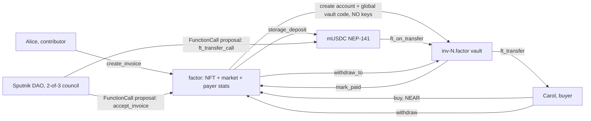

# FACTOR: DAO-approved invoices as NFTs that are their own bank account

Built at NEAR HACKATHON. Tracks: **NFTs That Do Something**, **Social Money**.

DAO contributors do the work, then wait weeks for a payout. With FACTOR the DAO approves your invoice onchain, the invoice becomes an NFT that owns its own keyless NEAR account (`inv-<id>.<factor>`), and you can sell it at a discount for cash today. When the DAO pays that address, **whoever holds the NFT gets paid**.

> **Status:** contracts, 58 unit tests and 21 sandbox integration tests are green, and the full story has been run end to end on **NEAR testnet** with `make deploy dao demo` (output in [`docs/demo-output.txt`](docs/demo-output.txt), every step below links its real transaction). The web UI builds and reads the deployed contracts, but its wallet flows have not yet been exercised in a browser.

## What it does (each line is backed by a passing test in `tests/tests/integration.rs`)

| Claim | Test |
|---|---|
| Creating an invoice mints an NFT and a **keyless** vault sub-account (0 access keys) running a **global contract** by hash | `t_vault_has_no_keys` |
| Only the named payer DAO can accept an invoice | `t_accept_only_dao` |
| …and a real **Sputnik DAO v2** proposal with 2 of 3 council votes executes `accept_invoice` | `t_accept_via_sputnik_proposal` |
| The DAO can pay the vault's address through a Sputnik `ft_transfer_call` proposal | `t_dao_pays_via_sputnik_proposal` |
| List / delist / buy an invoice NFT for NEAR; seller is paid, excess refunded | `t_happy_path`, `t_market_rules` |
| Fake payments, underpayment, double payment, and payment before acceptance are rejected or refunded | `t_fake_payment_rejected`, `t_underpay_refunded`, `t_double_pay_refunded`, `t_excess_refunded`, `t_pay_before_accept_refunded` |
| Only the **current** NFT owner can withdraw; the old owner is rejected | `t_old_owner_withdraw_fails` |
| No transfer/withdraw race; a failed withdraw unlocks and can be retried | `t_transfer_blocked_while_pending`, `t_withdraw_failure_unlocks` |
| Late payments count as late; overdue is derived | `t_late_payment_counts_late` |
| Public per-DAO payer score; live NFT metadata (NEP-171/177/181) | `t_nft_metadata_is_live`, unit tests in `contracts/factor/src/score.rs` |
| Spam invoices need a deposit covering storage | `t_create_requires_deposit` |
| AI agents and robots register on NEAR, pay only their own storage (rest refunded), can pause or deregister, and nobody else can edit their entry | `t_agent_and_robot_register_and_list`, `t_registry_rules` (`tests/tests/registry.rs`), 9 unit tests |

## Quick start

```bash
cp .env.example .env        # MASTER_ACCOUNT / MASTER_PRIVATE_KEY of a funded testnet account (~60 NEAR)
make build && make test     # contracts + sandbox tests, no network, no keys needed
make deploy dao demo        # full story on testnet, prints tx links   (needs .env)
make web                    # UI at http://localhost:3000             (after deploy)
```

Requirements: Linux/macOS/WSL2, Rust 1.95 (pinned by `rust-toolchain.toml`), [`cargo-near`](https://github.com/near/cargo-near) 0.23, [`near-cli-rs`](https://github.com/near/near-cli-rs), `jq`, `python3`, Node 22 (web only). The sandbox tests need Linux/macOS/WSL (the NEAR sandbox binary does not run on native Windows).

## Deployed (testnet)

| | |
|---|---|
| factor (NFT + market) | `factor.fctr6d9bf8.testnet` |
| mUSDC (mock token) | `musdc.fctr6d9bf8.testnet` |
| agent registry | `registry.fctr6d9bf8.testnet` (3 demo registrations: Carol Capital and Scout as agents, Rover-1 as a robot) |
| vault global code hash | `64WtqCUfEVtuu4JZt18k58WdfkjCzH6sGvZA5RU6m7X1` (published once; every vault uses it) |
| Sputnik DAO (2-of-3 council) | `fctr6d9bf8-dao.sputnik-v2.testnet` |
| demo vault | `inv-1.factor.fctr6d9bf8.testnet` (0 access keys, runs the global code above) |

Registry registrations on testnet: [Carol Capital](https://testnet.nearblocks.io/txns/AEtCjxJjVkJJahRKWyk1uJqtwFWBLSKcSayJYye11Wzn), [Scout](https://testnet.nearblocks.io/txns/Buj4y4SCvRPbW7T75XaWup5chz8RnvZ6BzECZ8JWiVai), [Rover-1 (robot)](https://testnet.nearblocks.io/txns/2fctxog18wM2mMhHuLNnGq6jLGf759c2hCLuxdvU2DcC). These are demo accounts we control, registered with `scripts/seed-agents.sh`; they are not independent third-party agents.

## Testnet proof (`make demo`)

| Step | Transaction |
|---|---|
| Alice creates invoice #1; keyless vault created | [97Qi…Mz9v](https://testnet.nearblocks.io/txns/97QimPKqbwYAe2Eae8QqshPjqGQHHQNjQupRHHWTMz9v) |
| Council proposal + 2 of 3 votes executes `accept_invoice` | [8kGf…Ucbe](https://testnet.nearblocks.io/txns/8kGfpbUPZZdzgoyVeSXG19WQeBjmEKTsWEmAZm5Ucbe) |
| Alice lists at 9.5 NEAR | [7JRV…1rmq](https://testnet.nearblocks.io/txns/7JRV8AwRvAcR1Ms9ApkYofVBZTmaBXixmccz3hty1rmq) |
| Carol buys; Alice receives 9.5 NEAR | [6Fe9…1vX](https://testnet.nearblocks.io/txns/6Fe9Ar5v67oxXMNL5NBRKeUDqpK9aR8fvvvqSfUhV1vX) |
| DAO pays 500 mUSDC to the vault address (second proposal + 2 votes); invoice PAID on time | [B3Fc…B3Rs](https://testnet.nearblocks.io/txns/B3FcFjCv7jUHqjiwtwLeMKBdpDkHfuHB4ZbmAEF3Q1Rs) |
| Alice (old owner) withdraws: rejected `ERR_NOT_OWNER` | [mTh2…WfTg](https://testnet.nearblocks.io/txns/mTh2Pf5oja7aVNC62epE52HxTbfpUDeLZegBWTQfTFG) |
| Carol withdraws 500 mUSDC; invoice SETTLED | [9W4B…CKBk](https://testnet.nearblocks.io/txns/9W4B8iQvp74TAgBL8PHDseu3jTMTyPZ294U7iDyycKBk) |

The vault's global-code reference and empty key list were also checked directly over RPC (`view_account` shows `global_contract_hash`, `view_access_key_list` returns `[]`).

## Architecture



- `contracts/factor`: NFT (NEP-171/177/181), market, state machine `Draft → Accepted → Paid → Settled`, payer stats, NEP-297 events.
- `contracts/vault`: deployed **once** as a global contract; every invoice account just references its hash. It has no method that adds keys or deploys code.
- `contracts/registry`: on-chain registry where agents and robots register with a public strategy (min payer score, min APR, max price). The strategy is published metadata; the agent's own code is responsible for following it, and the contract does not enforce it.
- `contracts/musdc`: mock USDC (NEP-141 + NEP-145, 6 decimals). **Testnet only:** `mint` is an open faucet.

## Security (threats → mitigation → test)

| # | Threat | Mitigation | Test |
|---|---|---|---|
| T1 | Fake payment: direct `ft_on_transfer` | predecessor must be the stablecoin | `t_fake_payment_rejected`, vault unit test |
| T2 | Fake `mark_paid` | predecessor must be the invoice's vault (a keyless vault cannot be impersonated) | `t_mark_paid_only_vault` |
| T3 | Non-DAO accepts | predecessor must be `payer_dao` | `t_accept_only_dao` |
| T4 | Old owner withdraws | owner checked at call time | `t_old_owner_withdraw_fails` |
| T5 | Transfer during an in-flight withdraw | `pending` lock blocks transfer, list, buy, withdraw | `t_transfer_blocked_while_pending` |
| T6 | Failed withdraw leaves funds locked | callback always unlocks; failure keeps PAID, retry works | `t_withdraw_failure_unlocks` |
| T7 | Keys added to the vault later | created with 0 keys; no such method exists | `t_vault_has_no_keys` |
| T8 | Underpayment marks PAID | full refund | `t_underpay_refunded` |
| T9 | Double payment | `paid` flag; second payment fully refunded | `t_double_pay_refunded` |
| T10 | Payer-score sybil | score weighted by volume and history; treasury shown next to it | unit tests in `score.rs` |
| T11 | Storage griefing | creation deposit must cover all storage | `t_create_requires_deposit` |
| T12 | Stale listing | cleared on any transfer or payment | `t_listing_cleared_on_transfer`, `t_listing_cleared_on_payment` |
| T13 | *(added)* DAO pays a Draft invoice and the funds get stuck | vault commits only after the factor accepts `mark_paid`, otherwise it refunds | `t_pay_before_accept_refunded` |

Design decisions and deviations from the PRD: [`docs/DECISIONS.md`](docs/DECISIONS.md).

## Limitations

- Testnet only. mUSDC is a mock token with an open faucet and no value.
- No partial payments (underpayment is refunded). mUSDC sent to a vault with a plain `ft_transfer` (not `ft_transfer_call`) is not recoverable.
- A DAO that never pays is not punished onchain beyond the public OVERDUE status and payer score; there is no collateral.
- The payer score's "age" is measured from the DAO's first acceptance on FACTOR (a contract cannot read an account's creation time).
- The implied APR in the UI uses a fixed demo rate (1 NEAR = 50 mUSDC) because the invoice is in mUSDC and the price in NEAR.
- The invoice timeline shows contract timestamps, not per-step transaction links (no indexer is used).
- The vault is ~113 KB, so deploying a new vault hash burns about 11 NEAR once on testnet.
- The web UI (light editorial theme; an ink-in-water splash intro with 3D FACTOR "F" and NEAR coins, a page slide-up and a `[F] FACTOR on NEAR [N]` lockup; scroll-animated landing page; agent marketplace; registration form; invoice market) is type-checked, builds, and was rendered in headless Edge against the live testnet contracts with no console errors. Its wallet sign-in and transaction flows have not been exercised with a real wallet yet.

## Future

Mainnet + native USDC, paying the vault from any chain via NEAR Intents, Trezu "approve/pay invoice" buttons, fractional invoices, DAO collateral / credit lines, agent buyers, protocol fee and payer-score API.
