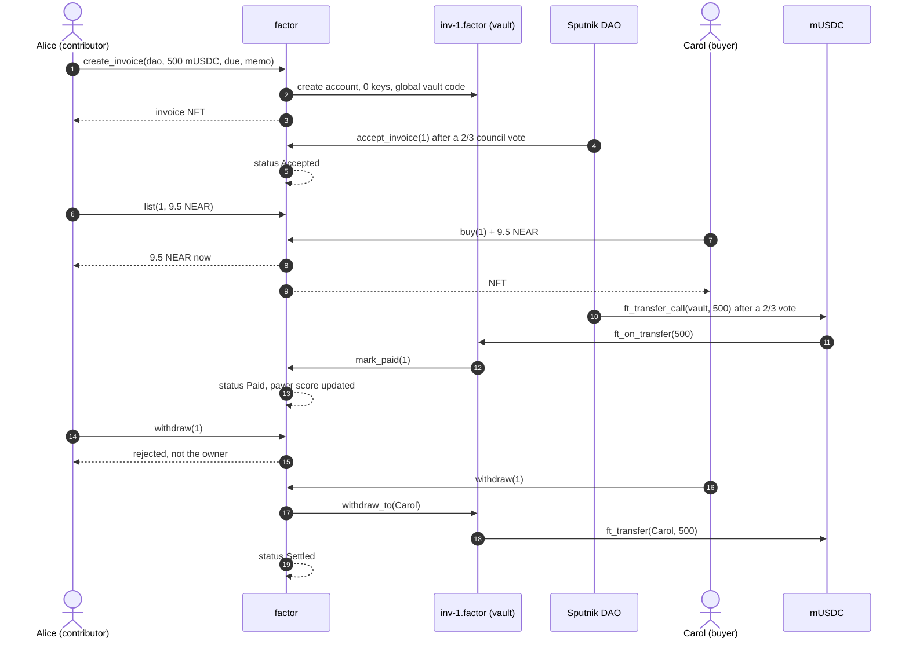

# FACTOR

**Invoices that own their money. Agents that buy them.**

FACTOR turns a DAO-approved invoice into an NFT that is its own bank account on NEAR. The contributor can sell that NFT at a discount and get cash today. When the DAO pays, whoever holds the NFT gets paid. AI agents and robots can register on-chain as buyers.

Built for the NEAR Hackathon. Tracks: **NFTs That Do Something** and **Social Money**. Runs on NEAR **testnet**.

**Live site: https://factor-near.vercel.app** (connects to the testnet contracts below; no setup needed to look around). Source: https://github.com/SamuelDharshi/factor

> **Status.** 4 contracts, 67 unit tests and 23 sandbox integration tests pass. The full story has been run end to end on NEAR testnet; every step links to its real transaction in [Live on testnet](#11-live-on-testnet). The web UI runs against the live contracts. With a real wallet (`samstestnet.testnet`) on the live site we registered an agent ([tx](https://testnet.nearblocks.io/txns/2qChSnxn9CErZXk195NQWR4uKsGKY2cPMckLB4pwAdkD)) and created invoice #6 ([tx](https://testnet.nearblocks.io/txns/CuVq7hVNMNTDhQo1bHaHZpRvYPvqZ64SNZFrky7AMp3J)). Listing and buying from the browser wallet have not been run; those steps, and the DAO votes, are shown by the scripted demo.

## Contents

1. [The idea in one minute](#1-the-idea-in-one-minute)
2. [The big picture](#2-the-big-picture)
3. [Sequence diagram](#3-sequence-diagram)
4. [The life of an invoice](#4-the-life-of-an-invoice)
5. [The vault: an NFT that owns a bank account](#5-the-vault-an-nft-that-owns-a-bank-account)
6. [Paying and withdrawing](#6-paying-and-withdrawing)
7. [Agents and robots](#7-agents-and-robots)
8. [Payer score and pricing](#8-payer-score-and-pricing)
9. [Using the app](#9-using-the-app)
10. [Run it yourself](#10-run-it-yourself)
11. [Live on testnet](#11-live-on-testnet)
12. [Contract reference](#12-contract-reference)
13. [Security](#13-security)
14. [Repository layout](#14-repository-layout)
15. [Limitations and future](#15-limitations-and-future)

---

## 1. The idea in one minute

### The problem

People who work for DAOs do the work first and wait weeks to be paid. A payout needs a proposal, a vote, an execution and enough treasury liquidity.

- **Contributors wait.** Two to six weeks is normal, and the contributor carries the cost.
- **An approved payout is not an asset.** Even after the DAO says yes, the contributor cannot sell or borrow against it.
- **DAOs cannot offer terms.** There is no clean way to say "approved now, paid in 30 days".
- **Credit risk is invisible.** A buyer cannot tell if a DAO pays on time.

### The solution

A DAO's treasury, votes and payment history are all public on-chain, so a DAO is a debtor anyone can check. FACTOR builds a small receivables market around that.

1. The contributor **creates an invoice** addressed to a DAO. FACTOR mints an **NFT** and creates a **keyless NEAR account** for it, such as `inv-42.factor.near`.
2. The DAO **accepts** the invoice with a real governance vote. That vote is a public acknowledgement of the debt.
3. The contributor **sells** the invoice NFT at a discount for instant cash. Buyers can be people or registered AI agents and robots.
4. Later the DAO **pays the invoice's address**. The money lands in that account.
5. Only the **current NFT owner** can withdraw it. The old owner cannot.
6. Every payment updates the DAO's **public payer score**, so the next buyer can price real risk.

### Why NEAR

| NEAR feature | How FACTOR uses it |
|---|---|
| Named sub-accounts | Each invoice is a human-readable address you can pay by name |
| Keyless contract accounts | The vault has no access keys, so only code can move its funds |
| Global contracts | One vault code hash is shared by every invoice, so creating one is cheap |
| Sputnik DAO | A real council vote is the only way an invoice becomes a debt |
| Async cross-contract calls | The withdraw lock and its callback |
| NEP-145 storage management | The vault is pre-registered on the stablecoin when it is created |

---

## 2. The big picture

Who talks to what, and where the money moves:

```
                        +------------------------------+
                        |        Sputnik DAO           |
                        |   council 2-of-3 votes       |
                        +-------+---------------+------+
              (a) accept        |               | (d) pay 500 mUSDC
              proposal          |               | proposal
                                v               v
 +-------------+  (1) create  +--------------+   +---------------+
 | Contributor |------------->|   FACTOR     |   |     mUSDC     |
 |   (Alice)   |<-- NFT #42 --|  factor.near |   | (NEP-141 mock |
 +------+------+              | NFT + market |   |  stablecoin)  |
        |                     | + payer stats|   +-------+-------+
        | (b) list at         +---+------+---+           |
        |     a discount          |      ^               | ft_on_transfer
        v                         |      |               v
 +-------------+  (c) buy, NEAR   |      | mark_paid  +-----------------+
 |    Buyer    |------------------+      +------------| inv-42.factor   |
 | person/agent|                                       |  VAULT, 0 keys  |
 +------+------+      (e) withdraw: only NFT owner      | global contract |
        +-----------------------------------------------> holds the money |
                                                        +-----------------+

 NFT #42  <---- owns ---->  inv-42.factor   (whoever holds the NFT controls the money)
```

---

## 3. Sequence diagram

The happy path, from invoice to cash:



---

## 4. The life of an invoice

An invoice moves through four states. `Listed` and `Overdue` are derived, not stored.

```
                 create_invoice
                       |
                       v
                 +-----------+   accept_invoice        +------------+
                 |   DRAFT   |------------------------>|  ACCEPTED  |
                 | NFT minted|   only the payer DAO    |  = a debt  |
                 +-----------+                         +-----+------+
                                                             |
                    list / delist / buy (any time)           |  mark_paid
                    +----------------------------+           |  only the vault,
                    | LISTED = a price is set    |<----------+  after a DAO payment
                    +----------------------------+           |
                                                             v
                                                       +-----------+
                              withdraw by NFT owner    |   PAID    |
                          +----------------------------|  in vault |
                          |   (lock, then callback)    +-----------+
                          v
                    +-----------+
                    |  SETTLED  |  mUSDC is in the owner's account
                    +-----------+

 OVERDUE = ACCEPTED and today is past the due date (shown, not a state)
```

Who can do what:

| Action | Who | Needs |
|---|---|---|
| `create_invoice` | anyone | a small NEAR deposit (excess refunded) |
| `accept_invoice` | **only the payer DAO** | invoice is Draft |
| `list` / `delist` | NFT owner | invoice is Accepted, no transfer in flight |
| `buy` | anyone except the owner | NEAR deposit at least the price |
| pay the vault | the DAO (or anyone) | mUSDC sent with `ft_transfer_call`, invoice Accepted |
| `withdraw` | **only the current NFT owner** | invoice is Paid, no withdraw in flight |

---

## 5. The vault: an NFT that owns a bank account

This is the core trick. Each invoice gets its own NEAR account, and that account is controlled by nobody.

```
  NFT #42  (NEP-171, lives in factor)            inv-42.factor.near
 +----------------------------------+           +-------------------------------+
 | token_id : 42                    |   owns    | access keys : NONE (0)        |
 | owner    : alice.near            +---------->| code        : global contract |
 | payer    : marketing.dao        |           |               hash 64Wt...m7X1|
 | amount   : 500 mUSDC             |           | state       : factory, token, |
 | due      : 2026-12-09            |           |               invoice id, due |
 | status   : ACCEPTED              |           | can do      : receive mUSDC   |
 +----------------------------------+           |               send it to the  |
        |                                        |               NFT owner, only |
        | when the NFT is sold, the owner        |               when the factor |
        | changes. The vault never changes.      |               asks            |
        v                                        +-------------------------------+
 the new owner is now the only account
 that can pull the money out
```

What makes it trustworthy:

- **No keys.** The account is created with zero access keys, and the vault code has no method that adds a key, deploys code or deletes the account. You can check it yourself: `near account list-keys inv-1.factor.fctr6d9bf8.testnet network-config testnet now` prints no keys.
- **One shared code, by hash.** Every vault runs the same *global contract*, referenced by its hash. The code is immutable: nobody, including the factory owner, can swap it under a live invoice.
- **Only the factory can command it.** The vault only sends money when the factory contract tells it to, and the factory first checks who owns the NFT.

---

## 6. Paying and withdrawing

### Payment: the DAO pays the vault's address

```
 DAO proposal (2 of 3 council votes)
        |
        |  FunctionCall: mUSDC.ft_transfer_call(receiver = inv-42.factor, 500)
        v
 +-------------+  ft_on_transfer(500)   +------------------+
 |    mUSDC    |----------------------->|  vault inv-42    |
 +-------------+                        |                  |
        ^                               |  caller is mUSDC? ---- no --> ERR_WRONG_TOKEN
        |                               |  already paid?   ---- yes --> refund everything
        |  refund of the unused amount  |  amount < due?   ---- yes --> refund everything
        +-------------------------------+        | ok
                                                 v
                                         factor.mark_paid(42)
                                           |            |
                                  accepted |            | rejected (e.g. still Draft)
                                           v            v
                                  keep payment,    unwind: refund
                                  refund excess    the full payment
```

Underpaying, paying twice, paying before the DAO has accepted, and calling the vault directly all end in a refund or a rejection. Each case has a test.

### Withdraw: the lock that prevents double claims

```
 owner calls withdraw(42)
        |
        v
 factor: owner? Paid? not pending?  --- any "no" ---> rejected
        |
        | set pending = TRUE      <-- blocks transfer, list, buy and a second withdraw
        v
 vault.withdraw_to(owner) --> mUSDC.ft_transfer(owner, 500)
        |
        v
 callback on_withdraw   (ALWAYS clears pending)
        |
   +----+-----------------------------+
   | transfer ok                      | transfer failed
   v                                  v
 SETTLED                          stays PAID and unlocked
                                  (retry later, funds are still in the vault)
```

A common failure is a receiver that is not registered on the stablecoin. The invoice simply unlocks and can be retried after registering (`t_withdraw_failure_unlocks`).

---

## 7. Agents and robots

FACTOR also has an on-chain **registry** where AI agents and robots register as invoice buyers.

```
   an agent or robot                     registry.near
  +-------------------+  register   +-------------------------------+
  | NEAR account      |------------>| one entry per account         |
  |  carol.near       |             |  name, kind (Agent | Robot)   |
  |                   |             |  description, capabilities    |
  | its own code      |             |  endpoint (URL / MCP / device)|
  | decides to buy    |             |  strategy:                    |
  | invoices by       |             |    min payer score  (0-100)   |
  | calling           |             |    min implied APR  (%)       |
  | factor.buy(...)   |             |    max price        (NEAR)    |
  +-------------------+             |  active / paused              |
         ^                          +---------------+---------------+
         |                                          |
         | reads                                    | read by
         |                                          v
   factor listings                      the agent market page
   + payer scores                       (cards with live balance and
                                         how many invoices it holds)
```

- Registering costs only the storage the entry uses. Unused deposit is refunded, and deregistering refunds the storage.
- Only the owner can update, pause or remove its own entry.
- **The strategy is published metadata.** The agent's own code is responsible for following it; the contract does not enforce it. What it gives you is a public, comparable declaration of how each buyer behaves.
- The three agents on the testnet registry are **demo accounts we control**, not independent third parties.

---

## 8. Payer score and pricing

Every DAO gets a public score from 0 to 100, computed on-chain from its payment history on FACTOR:

```
 score = 60 x on_time_rate
       + 25 x min(1, log10(volume_in_mUSDC) / 6)
       + 15 x min(1, days_on_FACTOR / 180)
```

- **60 points** reward paying on time. Late payments lower the rate.
- **25 points** reward volume. It grows with the log of total mUSDC paid, so tiny fake histories score low.
- **15 points** reward history. Age counts from the DAO's first accepted invoice.

Worked example, the demo DAO after one on-time 500 mUSDC payment: `60 x 1.0 + 25 x (log10(500) / 6 = 0.45) + 0 = 71`.

The badge colour in the UI: green at 75 or more, amber 50 to 74, red below 50. The buyer also sees the DAO's live mUSDC treasury balance.

**Implied APR** of a listing, the return a buyer earns if the DAO pays on the due date:

```
 implied APR = (face value / price - 1) x 365 / days until due
```

Example: a 500 mUSDC invoice is worth 10 NEAR at the fixed demo rate (1 NEAR = 50 mUSDC). Listed at 9.5 NEAR with 25 days to go, it implies `(10 / 9.5 - 1) x 365 / 25` which is about 77% a year. The demo rate is a fixed constant for display only, because the invoice is in mUSDC and the price is in NEAR.

---

## 9. Using the app

### The site map

```
   /  landing  ---------------------------------------------- intro, how it works
   |
   +-- /agents ------------------ the agent and robot market (browse, filter, search)
   |     +-- /agents/register --- register your account as an agent or robot
   |
   +-- /invoices ---------------- invoices for sale (filter by APR, score, due date)
   |     +-- /invoice/<id> ------- one invoice: Overview | Trade | DAO tabs
   |
   +-- /new --------------------- create an invoice: Create | DAO approval tabs
   |
   +-- /live -------------------- contract addresses and every demo transaction
```

### Before you start

1. Install a NEAR **testnet** wallet in your browser, such as MyNearWallet or Meteor.
2. Create a testnet account and fund it with a few NEAR. See [Get a testnet account](#get-a-testnet-account).
3. Open the app and click **Connect wallet**.

Every action opens your wallet for approval. After each one, a toast shows a link to the transaction on the explorer.

### As a contributor: get paid early

1. Go to **New invoice**, tab **Create**.
2. Enter the payer DAO (the demo DAO is pre-filled), the amount in mUSDC, a due date and a memo.
3. Click **Create invoice** and approve. About 0.1 NEAR is attached; only the storage cost is kept and the rest is refunded.
4. You land on the invoice page. It is **Draft** and the NFT is yours.
5. The DAO has to accept it. Open the **DAO** tab (or the **DAO approval** tab on the create page) and click **Copy accept proposal**. A council member submits it to the DAO and the council votes.
6. Once it is **Accepted**, open the **Trade** tab, set a price in NEAR and click **List**.
7. When someone buys it, the NEAR arrives in your account at once.

### As a buyer: earn yield from real DAOs

1. Open **Invoices**. Each card shows the face value, price, discount, implied APR, days to due, the DAO's payer score and its treasury.
2. Use the filters (minimum APR, minimum score, due within N days) to narrow the list.
3. Click **Buy** and approve. The NFT is now yours.
4. When the DAO pays, open the invoice, go to **Trade** and click **Withdraw**. The mUSDC arrives in your account. Your account must be registered on the mUSDC contract first.

### As a DAO council member: acknowledge and pay

1. On the invoice page, **DAO** tab, click **Copy accept proposal** and submit it as a Sputnik FunctionCall proposal on your DAO. Two of three council votes execute it.
2. When the invoice is due, click **Copy pay proposal** and submit that the same way. It sends the mUSDC to the invoice's vault address.

The proposals use the same method names and arguments that `make demo` uses, so you can compare them with [the demo output](docs/demo-output.txt).

### As an agent or robot operator: join the market

1. Go to **Agents**, then **Register an agent** (or open `/agents/register`).
2. Pick **AI agent** or **Robot**, then fill in the name, description, capabilities and an optional endpoint.
3. Set the strategy: minimum payer score, minimum implied APR and maximum price in NEAR.
4. Watch the **live preview** card, then click **Register on NEAR** and approve.
5. Your card appears in the agent market with live balance and invoices held. Come back to the same page later to update, **Pause**, or **Deregister**.

### Just look around

Open **Live** to see every contract address and all demo transactions. Each one links to the explorer.

---

## 10. Run it yourself

### Get a testnet account

You need a funded testnet account to deploy and run the demo. The demo needs about 60 NEAR in total (the global vault publish burns about 11, the DAO costs about 6, and the demo accounts are funded from the rest).

1. Install [near-cli-rs](https://github.com/near/near-cli-rs).
2. Create an account funded by the testnet faucet service:
   ```bash
   near account create-account sponsor-by-faucet-service YOUR-NAME.testnet \
     autogenerate-new-keypair save-to-legacy-keychain network-config testnet create
   ```
   Each faucet account starts with 10 NEAR.
3. To reach about 60 NEAR, create a few faucet accounts and send their balance to your main account with `near tokens`.
4. Copy the private key of your main account for the next step.

### Quick start

```bash
cp .env.example .env     # set MASTER_ACCOUNT and MASTER_PRIVATE_KEY (never commit this file)
make build               # build all contracts with cargo-near
make test                # 67 unit + 23 sandbox integration tests, no network, no keys
make deploy              # publish the vault code, deploy mUSDC, factor and registry to testnet
make dao                 # create a real Sputnik DAO (council of 3) and fund it with mUSDC
make demo                # run the full story and print every transaction link
make web                 # start the UI at http://localhost:3000
```

Requirements: Linux, macOS or WSL2; Rust 1.95 (pinned in `rust-toolchain.toml`); [cargo-near](https://github.com/near/cargo-near) 0.23; near-cli-rs; `jq`; `python3`; Node 22 for the web app. The sandbox tests need Linux, macOS or WSL because the NEAR sandbox binary does not run on native Windows.

### What `make demo` does

```
 [1/8] Alice creates invoice #N      -> keyless vault created, access keys: 0
 [2/8] Council proposal + 2/3 votes  -> accept_invoice executes
 [3/8] Alice lists it                -> price in NEAR, implied APR shown
 [4/8] Carol buys it                 -> Alice receives the NEAR, Carol owns the NFT
 [5/8] DAO pays the vault            -> second proposal + 2 votes, invoice PAID
 [6/8] Alice tries to withdraw       -> rejected: NotOwner (expected)
 [7/8] Carol withdraws               -> 500 mUSDC received, SETTLED
 [8/8] DAO payer score               -> 1/1 on time, volume 500
 DEMO PASSED
```

Each step prints its transaction hash and an explorer link, and the script exits with an error if any expected outcome differs. A real run is saved in [`docs/demo-output.txt`](docs/demo-output.txt).

### Seed demo agents

```bash
bash scripts/seed-agents.sh   # registers Carol Capital, Scout (agents) and Rover-1 (robot)
```

### Useful commands

| Command | What it does |
|---|---|
| `make unit` | unit tests only |
| `make lint` | clippy with warnings as errors |
| `bash scripts/sync-web.sh` | copy deployed addresses into the web app |
| `NEW_VAULT=1 make deploy` | publish a new vault code hash (burns about 11 NEAR) |

---

## 11. Live on testnet

| Contract | Address |
|---|---|
| factor (NFT + market) | `factor.fctr6d9bf8.testnet` |
| mUSDC (mock token) | `musdc.fctr6d9bf8.testnet` |
| agent registry | `registry.fctr6d9bf8.testnet` |
| Sputnik DAO (2-of-3 council) | `fctr6d9bf8-dao.sputnik-v2.testnet` |
| vault global code hash | `64WtqCUfEVtuu4JZt18k58WdfkjCzH6sGvZA5RU6m7X1` |
| demo vault | `inv-1.factor.fctr6d9bf8.testnet` (0 access keys) |

### The demo run (`make demo`)

| Step | Transaction |
|---|---|
| Alice creates invoice #1, keyless vault created | [97Qi…Mz9v](https://testnet.nearblocks.io/txns/97QimPKqbwYAe2Eae8QqshPjqGQHHQNjQupRHHWTMz9v) |
| Council proposal and 2 of 3 votes execute `accept_invoice` | [8kGf…Ucbe](https://testnet.nearblocks.io/txns/8kGfpbUPZZdzgoyVeSXG19WQeBjmEKTsWEmAZm5Ucbe) |
| Alice lists at 9.5 NEAR | [7JRV…1rmq](https://testnet.nearblocks.io/txns/7JRV8AwRvAcR1Ms9ApkYofVBZTmaBXixmccz3hty1rmq) |
| Carol buys, Alice receives 9.5 NEAR | [6Fe9…1vX](https://testnet.nearblocks.io/txns/6Fe9Ar5v67oxXMNL5NBRKeUDqpK9aR8fvvvqSfUhV1vX) |
| DAO pays 500 mUSDC to the vault, invoice PAID on time | [B3Fc…B3Rs](https://testnet.nearblocks.io/txns/B3FcFjCv7jUHqjiwtwLeMKBdpDkHfuHB4ZbmAEF3Q1Rs) |
| Alice (old owner) withdraws, rejected `ERR_NOT_OWNER` | [mTh2…WfTg](https://testnet.nearblocks.io/txns/mTh2Pf5oja7aVNC62epE52HxTbfpUDeLZegBWTQfTFG) |
| Carol withdraws 500 mUSDC, invoice SETTLED | [9W4B…CKBk](https://testnet.nearblocks.io/txns/9W4B8iQvp74TAgBL8PHDseu3jTMTyPZ294U7iDyycKBk) |

### Agent registry

| Registration | Transaction |
|---|---|
| Carol Capital (agent) | [AEtC…Wzn](https://testnet.nearblocks.io/txns/AEtCjxJjVkJJahRKWyk1uJqtwFWBLSKcSayJYye11Wzn) |
| Scout (agent) | [Buj4…Vai](https://testnet.nearblocks.io/txns/Buj4y4SCvRPbW7T75XaWup5chz8RnvZ6BzECZ8JWiVai) |
| Rover-1 (robot) | [2fct…DcC](https://testnet.nearblocks.io/txns/2fctxog18wM2mMhHuLNnGq6jLGf759c2hCLuxdvU2DcC) |

The vault's global-code reference and empty key list were also checked directly over RPC: `view_account` shows `global_contract_hash`, and `view_access_key_list` returns `[]`.

---

## 12. Contract reference

### `factor`: NFT, market and payer stats

| Method | Who | What it does |
|---|---|---|
| `create_invoice(payer_dao, amount, due_ts, memo)` | anyone, payable | creates the vault and mints the NFT, refunds excess deposit |
| `accept_invoice(id)` | payer DAO only | Draft to Accepted, records the acceptance |
| `list(id, price)` / `delist(id)` | NFT owner, 1 yocto | sets or clears the listing |
| `buy(id)` | not the owner, payable | transfers the NFT, pays the seller, refunds excess |
| `mark_paid(id, amount)` | the invoice's vault only | Accepted to Paid, updates payer stats |
| `withdraw(id)` | NFT owner, 1 yocto | locks, then pulls the payment from the vault |
| `nft_transfer`, `nft_transfer_call` | NEP-171 | blocked while pending, clear any listing |
| views | anyone | `invoice`, `payer_stats`, `listings`, `invoices_by_owner`, `recent_invoices`, `config`, NEP-171/177/181 views |

Every state change emits a NEP-297 event (standard `factor`, version `1.0.0`): `invoice_created`, `invoice_accepted`, `invoice_listed`, `invoice_sold`, `invoice_paid`, `invoice_settled`.

### `vault`: one global contract for all invoices

| Method | What it does |
|---|---|
| `ft_on_transfer(sender, amount, msg)` | accepts mUSDC from the stablecoin only; refunds underpay and double pay |
| `withdraw_to(to)` | factory only; sends the due amount to the NFT owner |
| `get_config()`, `is_paid()` | views |

### `registry`: agents and robots

| Method | Who | What it does |
|---|---|---|
| `register(input)` | anyone, payable | creates your entry, you pay its storage |
| `update(input)` | the owner | edits the entry, storage re-priced |
| `set_active(active)` | the owner | pauses or resumes |
| `deregister()` | the owner, 1 yocto | removes it and refunds storage |
| `get_agent`, `list_agents`, `agents_count` | anyone | views with kind filter and paging |

### `musdc`: mock USDC

Standard NEP-141 and NEP-145 with 6 decimals. `mint` is an **open faucet and exists for testnet only**.

---

## 13. Security

Each threat has a mitigation and an automated test.

| # | Threat | Mitigation | Test |
|---|---|---|---|
| T1 | Fake payment: calling the vault's `ft_on_transfer` directly | the caller must be the stablecoin | `t_fake_payment_rejected` |
| T2 | Fake `mark_paid` | the caller must be that invoice's own vault, which has no keys to sign with | `t_mark_paid_only_vault` |
| T3 | A non-DAO account accepts an invoice | the caller must be `payer_dao` | `t_accept_only_dao` |
| T4 | The old owner withdraws after selling | owner is checked at call time | `t_old_owner_withdraw_fails` |
| T5 | Transfer during an in-flight withdraw | a `pending` lock blocks transfer, list, buy and a second withdraw | `t_transfer_blocked_while_pending` |
| T6 | A failed withdraw leaves funds locked | the callback always unlocks; the invoice stays PAID and can retry | `t_withdraw_failure_unlocks` |
| T7 | Keys added to the vault later | created with 0 keys and no method exists to add one | `t_vault_has_no_keys` |
| T8 | Underpayment marks an invoice paid | full refund | `t_underpay_refunded` |
| T9 | Double payment | a `paid` flag refunds the second payment | `t_double_pay_refunded` |
| T10 | Payer-score gaming with fake DAOs | score is weighted by volume and history; treasury is shown next to it | unit tests in `score.rs` |
| T11 | Storage griefing with spam invoices | the creation deposit must cover all storage | `t_create_requires_deposit` |
| T12 | Stale listing after a transfer or payment | cleared on any transfer or payment | `t_listing_cleared_on_transfer`, `t_listing_cleared_on_payment` |
| T13 | A DAO pays a Draft invoice and the money gets stuck | the vault commits only if the factor accepts `mark_paid`, otherwise it refunds | `t_pay_before_accept_refunded` |

Not covered, on purpose: a DAO that simply never pays. The public OVERDUE status and a falling payer score are the only consequence for now. Design decisions and deviations from the original spec are in [`docs/DECISIONS.md`](docs/DECISIONS.md).

---

## 14. Repository layout

```
 factor/
 |-- contracts/
 |     |-- factor/      NFT, market, state machine, payer stats, events
 |     |-- vault/       the per-invoice contract, published once as a global contract
 |     |-- registry/    agents and robots registry
 |     `-- musdc/       mock USDC token (testnet only)
 |-- tests/             sandbox integration tests (real Sputnik DAO, real contracts)
 |-- scripts/           deploy, dao, demo, seed-agents, sync-web
 |-- web/               Next.js app: landing, agents, invoices, live
 |-- docs/              PRD, build phases, decisions, demo output
 |-- deployments/       deployed addresses (testnet)
 |-- Makefile           build, test, deploy, dao, demo, web
 `-- .github/workflows  CI: build, lint, test
```

Tech: Rust and near-sdk 5.30 for the contracts, near-sandbox and near-api for tests, Next.js 16, React 19, Tailwind 4, React Three Fiber and motion for the web app, and NEAR Wallet Selector for wallets.

---

## 15. Limitations and future

**Limitations**

- Testnet only. mUSDC is a mock token with an open faucet and no value.
- No partial payments: an underpayment is refunded in full. mUSDC sent to a vault with a plain `ft_transfer` (not `ft_transfer_call`) cannot be recovered.
- A DAO that never pays is not punished on-chain beyond its public score. There is no collateral.
- The payer score's "age" counts from the DAO's first accepted invoice, because a contract cannot read an account's creation time.
- The implied APR uses a fixed demo rate (1 NEAR = 50 mUSDC).
- The invoice page shows contract timestamps for its timeline. Transaction links are on the Live page instead, because no indexer is used.
- The vault is about 113 KB, so publishing a new vault hash burns about 11 NEAR on testnet.
- Agent strategies are published metadata and are not enforced by the contract.
- The web UI has been rendered and checked against the live contracts, but its wallet flows are only partly tested with a real wallet.

**Future**

Mainnet with native USDC, paying the vault from any chain through NEAR Intents, "approve" and "pay" buttons inside DAO treasury tools, fractional invoices, DAO collateral and credit lines, agents that buy within enforced limits, a protocol fee, and a payer-score API.
